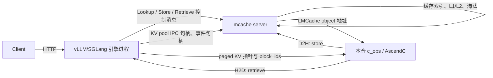

# LMCache-Ascend 代码调用图：从请求入口到 KV Cache 分配、注册与搬运

> 面向第一次阅读本仓库的开发者。
>
> 本文以当前分支的 **MP（Multi-Process，多进程）模式**为主线，并在末尾给出旧
> in-process（进程内）模式的对照调用链。源码中已经补充中文注释；本文负责把这些
> 注释串成完整的执行路径。

## 1. 先建立正确的代码边界

读懂本仓库最重要的一点是：**LMCache-Ascend 不是完整的 LMCache，也不是完整的
vLLM/SGLang。** 它是昇腾插件，主要提供 NPU 原生算子、内存注册和布局适配。

| 能力 | 实现位置 | 本文标记 |
| --- | --- | --- |
| HTTP 请求、tokenize、调度、模型 forward | 上游 vLLM/SGLang | `[引擎/上游]` |
| `LMCacheMPConnector`、ZMQ 控制面、`lmcache server` | 上游 LMCache | `[LMCache/上游]` |
| 生产环境的缓存索引、Lookup、L1/L2 淘汰 | 上游 LMCache | `[LMCache/上游]` |
| NPU KV pool 的 IPC 包装和 cache context | 上游 LMCache 的 NPU 平台层 | `[LMCache/上游]` |
| NPU 插件激活、布局补丁、原生函数导出 | **本仓库** | `[本仓]` |
| 锁页内存分配、Host 注册、设备地址查询 | **本仓库** | `[本仓]` |
| AscendC KV block 搬运、异步事件和完成通知 | **本仓库** | `[本仓]` |

因此，看到“请求进入”时不要在本仓库里寻找 HTTP handler；看到“生产环境 Lookup”时
也不要把测试中的 `_FakeStorageManager` 当成真实缓存服务。本文只对本仓能够核实的
函数给出函数级调用关系，上游部分明确标出边界，不虚构其内部实现。

## 2. 新手先懂的八个概念

### 2.1 KV Cache

模型做自注意力计算时，每层都会为 token 产生 K（Key）和 V（Value）。已经算过的
前缀 KV 可以复用，从而避免下一个相同前缀请求重复执行完整 prefill。

### 2.2 block、page、chunk

- **block/page**：推理引擎内部管理 KV 的分页单位；`block_ids` 指向这些物理页。
- **chunk**：LMCache 对外缓存和查找的 token 分块单位。
- 一个 LMCache 对象可以覆盖多个引擎 block，所以 native 传输前会校验
  `blocks_per_object * bs == lmcache_chunk_size`。

### 2.3 LMCache memory object

LMCache 用来保存一个 chunk 的连续内存对象。它可能位于普通 CPU 内存、锁页内存、
命名共享内存或 NPU 内存。本仓 native 层最终需要的是它可被 NPU kernel 访问的地址。

### 2.4 plane

plane 是一个物理 KV 数据平面。例如：

- 普通 K/V：K 一个 plane，V 一个 plane；
- MLA/DSA：latent、rope/scale 等数据可以是不同 plane；
- 不同 plane 可以有不同宽度、dtype 和 block stride。

### 2.5 pointer table

NPU kernel 不直接接收 Python Tensor 列表，而是接收一个 NPU 上的 `int64` 指针表。
格式 16/17 通常按 `(layer, plane)` 保存指针；格式 2 可以每层只保存一个基址，再加
plane 偏移。

### 2.6 H2D 与 D2H

在本仓 MP 接口里，它们表示逻辑数据方向：

| 枚举 | 逻辑方向 | 对应操作 |
| --- | --- | --- |
| `H2D = 0` | LMCache object → 引擎 paged KV | **retrieve / load / scatter** |
| `D2H = 1` | 引擎 paged KV → LMCache object | **store / save / gather** |

名称虽然叫 Host-to-Device/Device-to-Host，但 LMCache object 经 IPC 或注册后也可能
已经是设备虚拟地址，所以不能简单理解为每一步都发生 CPU↔NPU 拷贝。

### 2.7 注册不等于分配

本仓存在几种容易混淆的“注册”：

1. 引擎向 LMCache 注册 KV pool 和布局：上游 NPU IPC/cache context 负责；
2. `aclrtHostRegister/halHostRegister`：把已有 Host 内存注册为可映射内存；
3. `register_mapping`：只把已有 Host↔Device 映射记录进本仓注册表；
4. `storage_manager.batched_put`：旧 in-process 路径发布 key→object 缓存映射。

它们不是同一个动作，也不发生在同一层。

### 2.8 入队不等于完成

native 函数返回，通常只表示 memcpy/kernel 已提交到 NPU stream。读取结果、复用临时
buffer 或释放相关内存前，必须等待相应 stream/event；调用 `drain_recorded_events` 或
`drain_recorded_completions` 本身也**不会同步 stream**。

## 3. 总体运行结构与真正入口

### 3.1 两个启动命令

当前 MP 部署有两个独立入口：

```text
入口 A：lmcache server ...                         [LMCache/上游]
入口 B：vllm serve ... --kv-transfer-config \
        '{"kv_connector":"LMCacheMPConnector", ...}' [引擎/上游]
```

SGLang MP 的挂接方式见 [SGLang 适配教程](../sglang_mp_mode/adaptation_walkthrough.md)。
本仓没有 `main()` 形式的 HTTP 服务入口，也没有实现 `LMCacheMPConnector`。

### 3.2 进程关系



### 3.3 本仓代码被加载的入口

上游 NPU 平台初始化需要原生实现时，会导入 `lmcache_ascend.c_ops`。Python 在导入子
模块前先执行包的 `__init__.py`，于是形成下面的入口：

```text
[LMCache/上游] NpuDeviceOps.ensure_native
  → import lmcache_ascend.c_ops
    → 先执行 lmcache_ascend/__init__.py                 [本仓]
      → _seed_partial_lmcache_device_ops()
      → 如果是 vLLM 运行时：_patch_logical_block_size()
      → _patch_make_page_buffer_shape_desc()
    → 加载编译出的 c_ops 扩展                           [本仓]
      → csrc/pybind.cpp::PYBIND11_MODULE(c_ops, m)
  → 上游 ops/bind_native 获取 NPU 函数与 PageBufferShapeDesc
```

对应源码：

- [lmcache_ascend/__init__.py](../../lmcache_ascend/__init__.py)
- [lmcache_ascend/ops.py](../../lmcache_ascend/ops.py)
- [csrc/pybind.cpp](../../csrc/pybind.cpp)

## 4. 插件初始化：每个函数为什么执行

### 4.1 解决“LMCache 只导入了一半”的循环依赖

```text
_seed_partial_lmcache_device_ops
  → 检查 lmcache.device_ops 是否已存在
  → 不存在则安装 _LazyDeviceOpsProxy
      → __getattr__(name)
          1. 已有真实 device_ops：委托真实单例
          2. 否则查询 lmcache_ascend.c_ops 同名符号
          3. 扩展没有时回退上游 torch DeviceOps
  → 上游 LMCache 初始化完成后，用真实单例替换代理
```

这个代理不负责 KV 搬运，它只保证插件激活期间的其他模块可以安全执行
`from lmcache import device_ops`。

### 4.2 安装逻辑 block 大小补丁

```text
_patch_logical_block_size
  → install_overrides
      → install_logical_block_size
          → install_on
              → _wrap_merge
                  → merge 包装器
                      → 原 merge
                      → _restore_dropped_merge_fields
      → _ascend_block_size_is_physical（未显式传 scale_physical 时）
          → _block_size_is_physical
      → 物理 block：_wrap_get_tokens_per_block
          → get_tokens_per_block 包装器
              → tokens_per_block_id
              → DCP > 1 且为 attention spec 时乘 dcp_size
          → _rebind_get_tokens_per_block
```

目的不是修改引擎 KV pool，而是让 LMCache 知道“一个物理 block ID 实际覆盖多少逻辑
token”。新版 spec 已经提供逻辑 `block_size` 时会跳过 `get_tokens_per_block` 包装。

源码：[logical_block_size.py](../../lmcache_ascend/integration/vllm/logical_block_size.py)。

### 4.3 安装 plane 几何补丁

```text
_patch_make_page_buffer_shape_desc
  → install_plane_geometry_fill
      → 保存上游原 make_page_buffer_shape_desc
      → 安装同名包装器
          → original(...) 先填普通标量字段
          → 格式 16/17 再读取该层 plane tensors
          → 填 desc.num_planes
          → 填 desc.plane_slot_bytes
          → 填 desc.plane_block_stride_bytes
          → 返回 desc
```

- `plane_slot_bytes[p]`：plane `p` 每个 token slot 的有效载荷字节数；
- `plane_block_stride_bytes[p]`：引擎侧沿 block 维前进一步的字节数；
- 后续 `prepare_group` 把这些字段解析成 native kernel 使用的纯字节布局。

源码：[shape_desc.py](../../lmcache_ascend/v1/shape_desc.py)。

## 5. KV pool 的分配、导出与注册

### 5.1 用本仓 E2E 测试观察真实 IPC 边界

[test_npu_lmcache_driven_e2e.py](../../tests/v1/multiprocess/test_npu_lmcache_driven_e2e.py)
使用真实 NPU IPC、cache context 和传输模块，只把存储服务替换成测试 fake。它展示了
本仓能够直接验证的注册链：

```text
_worker(device_index, conn)                                [测试 worker]
  → torch.npu.set_device
  → 每层 torch.zeros(...) 分配 latent/rope NPU planes
  → NpuIPCWrapper.wrap((latent, rope))                    [LMCache/上游]
  → 创建并 record 两个 interprocess torch.npu.Event
  → customized encoder 编码 wrappers
  → conn.send({wrappers, producer_a, producer_b, device_index})
  → conn.recv() 阻塞，保持 worker 映射存活

父进程 test_lmcache_driven_store_and_retrieve_roundtrip
  → parent_conn.recv()
  → customized decoder 解码 wrappers
  → NpuDeviceSpec().create_cache_context(...)             [LMCache/上游]
      → 导入 IPC 地址、识别 KV 布局、建立 cache context
      → 构造 PageBufferShapeDesc 时经过本仓安装的包装器    [本仓]
  → 创建 LMCacheDrivenTransferModule                      [LMCache/上游]
  → module.store(...) / module.retrieve(...)
```

### 5.2 哪些对象由谁分配

| 对象 | 分配者 | 本仓是否拥有 |
| --- | --- | --- |
| 引擎 paged KV planes | 引擎；测试中是 `_worker` 的 `torch.zeros` | 否，只消费地址 |
| 引擎 pointer table | 上游 cache context | 否 |
| `block_ids` | 上游调用方 | 否 |
| 生产 LMCache L1 object | 上游 StorageManager | 否 |
| 测试 LMCache object | `_FakeStorageManager.reserve_write` 的 CPU `torch.empty` | 测试所有 |
| 锁页 Host buffer | 本仓 `alloc_pinned_ptr/alloc_pinned_numa_ptr` | 由调用方配对释放 |
| direct 路径临时 NPU staging | `prepare_lmc_ptrs` 的 `torch::empty` | native 按传输契约管理 |
| plan 路径临时对象 | 上游 plan builder/cache context | 否 |

**注意：** `_FakeStorageManager` 只是用字典和 CPU Tensor 模拟对象存取，不包含生产
环境的索引、锁、 eviction 或完整生命周期。

## 6. 锁页内存：分配 → 注册 → 查地址 → 注销 → 释放

### 6.1 Python 到 C++ 的入口

[csrc/pybind.cpp](../../csrc/pybind.cpp) 将以下函数暴露到 `lmcache_ascend.c_ops`：

```text
alloc_pinned_ptr(size, flags)       → csrc/mem_alloc.cpp::alloc_pinned_ptr
free_pinned_ptr(ptr)                → csrc/mem_alloc.cpp::free_pinned_ptr
alloc_pinned_numa_ptr(size, node)   → csrc/mem_alloc.cpp::alloc_pinned_numa_ptr
free_pinned_numa_ptr(ptr, size)     → csrc/mem_alloc.cpp::free_pinned_numa_ptr
register_mapping(host, dev, size)   → csrc/managed_mem.cpp::register_mapping
unregister_ptr(ptr)                 → csrc/managed_mem.cpp::unregister_ptr
get_device_ptr(ptr)                 → csrc/managed_mem.cpp::get_device_ptr
```

### 6.2 普通锁页内存完整链路

```text
alloc_pinned_ptr
  → aclrtMallocHost                         分配 Host 锁页内存
  → 非 310 或无法识别 SoC：register_ptr
      → HostRegisteredMemoryManager::GetInstance
      → get_driver_version
      → is_version_at_least_25
      → 新驱动：registerHostPtr
          → aclrtHostRegister(..., ACL_HOST_REGISTER_MAPPED, ...)
          → allocatedMap[host] = {host, device, size, -1}
      → 旧驱动：halRegisterHostPtr
          → halHostRegister
          → mlock
          → allocatedMap[host] = {host, device, size, device_id}
  → 返回 Host 地址（不是 device VA）

之后 native 需要设备地址：
get_device_ptr(host_pointer_or_interior_pointer)
  → HostRegisteredMemoryManager::getDevicePtr
      → 在 allocatedMap 做区间查找
      → offset = host_addr - record.ptr
      → 返回 record.devptr + offset

释放：
free_pinned_ptr
  → unregister_ptr
      → 按驱动版本选择 aclUnregisterHostPtr / halUnregisterHostPtr
  → aclrtFreeHost
```

### 6.3 NUMA 路径

```text
alloc_pinned_numa_ptr
  → mmap
  → mbind 到指定 NUMA node
  → memset 触发物理页落实
  → register_ptr
  → 返回 Host 地址

free_pinned_numa_ptr
  → unregister_ptr
  → munmap
```

### 6.4 `register_mapping` 为什么不是分配函数

```text
register_mapping(hostPtr, devPtr, size)
  → HostRegisteredMemoryManager::registerMappedMem
      → 校验三个参数
      → 将已有映射写入 allocatedMap
      → 返回记录中的 devPtr
```

它没有调用 `malloc/mmap/aclrtMallocHost`，也没有调用 ACL/HAL HostRegister；因此调用方
必须保证映射真实有效，并自行管理底层内存生命周期。

源码：[mem_alloc.cpp](../../csrc/mem_alloc.cpp)、[managed_mem.cpp](../../csrc/managed_mem.cpp)、
[managed_mem.h](../../csrc/managed_mem.h)。

## 7. 第一次请求：KV Store 完整调用链

下面以 LMCache-driven MP 为主线。请求调度、前缀 Lookup 和生产 StorageManager 在上游；
进入 native 后，每一步都能在本仓定位。

### 7.1 控制面到数据面

```text
Client 请求 A                                                    [引擎/上游]
  → 模型 prefill 产生各层 paged KV
  → LMCacheMPConnector 发起缓存保存                              [LMCache/上游]
  → LMCacheDrivenTransferModule.store(...)                      [LMCache/上游]
      → 等待/导入引擎 producer event
      → 生产 StorageManager 为 chunk reserve_write               [LMCache/上游]
      → 准备 cache context、block_ids、LMCache object 地址
      → 调用 NPU device_ops 的块传输能力
          → ops.py 暴露的 c_ops.multi_layer_block_kv_transfer     [本仓]
          或 c_ops.execute_object_group_transfer                 [本仓]
      → 提交流完成通知
  → 请求 A 后续 decode/返回                                      [引擎/上游]
```

E2E 中对应的可执行调用是：

```text
module.store(key, 1, block_ids, message["producer_a"])
  → 返回 (store_handle, stored)
  → cache_context.stream.synchronize()
  → 再读取 storage_manager.objects[CHUNK_KEY]
```

测试显式同步是为了在断言前等待异步传输完成，不代表生产模块每次都以同样方式阻塞。

### 7.2 direct native 入口逐函数展开

```text
Python: c_ops.multi_layer_block_kv_transfer(...)                 [本仓]
  → pybind.cpp 中的参数转换 lambda
      → direction 转 TransferDirection
      → engine_kv_format 转 EngineKVFormat
      → 释放 GIL
      → C++ multi_layer_block_kv_transfer
          → OptionalDeviceGuard(device)
          → query_ub_budget_bytes
          → prepare_group                       静态布局解析与校验
              → checked_mul / checked_add
              → 生成 PreparedGroup + BlockTransferLayout
          → validate_launch                     动态参数校验
              → 检查对象数、块数、chunk、skip、block_ids 边界
          → 校验 pointer table 和 block_ids Tensor
          → direction == D2H ⇒ to_engine = false
          → prepare_lmc_ptrs
              → get_device_ptr：已注册 Host 映射？
              → is_npu_memory_ptr：已是 NPU 地址？
              → 都不是：torch::empty 创建 NPU HostStage
          → getCurrentNPUStream().stream()
          → enqueue_block_transfer
              → partial D2H 且 HostStage：先 H2D 读出原对象，保留 skip 前缀
              → launch_prepared_objects
                  → 每个 LMCache object 调一次
                    kvcache_ops::multi_layer_block_transfer_kernel
              → D2H 且 HostStage：再 D2H 写回 Host object
          → 返回；此时只保证已入队
```

### 7.3 Store 在 AscendC kernel 内怎样搬

```text
kvcache_ops::multi_layer_block_transfer_kernel（Host launcher）
  → ::multi_layer_block_transfer_kernel<<<block_dim, ..., stream>>>
      → 重建 BlockTransferLayout
      → MultiLayerBlockTransfer.Init
          → 保存指针表、object、block_ids 和布局
          → MaxAlignedRowBytes
          → 计算 tokens_per_segment_
          → pipe->InitBuffer 初始化 UB 队列
      → to_engine == false，所以 Process<false>
          → 将 work item 映射为 (layer, plane, block)
          → block_ids_[block] 找引擎物理 block
          → ProcessPlaneBlock<false>
              → ResolveEnginePlanePtr：定位引擎 plane 基址
              → LmcGlobalOffset：定位 LMCache object 内偏移
              → 按 UB 容量分段
              → engine GM → UB：DataCopy 或 CopyRowsToUb
              → UB → LMCache GM：DataCopy 或 CopyUbToRows
              → queue_.FreeTensor
```

这就是 **store = 从引擎分散的 paged blocks gather 到 LMCache 连续对象** 的最底层实现。

## 8. 第二个相同前缀请求：Lookup 与 Retrieve

### 8.1 Lookup 在哪里

MP 模式下，token 前缀 hash、Lookup 请求和命中长度判断属于上游 LMCache/引擎控制面。
本仓没有 MP 版 `lookup()` 实现。命中后才需要把缓存内容回灌到引擎 KV pool：

```text
Client 请求 B，前缀与 A 相同                                    [引擎/上游]
  → 上游 Lookup 命中已有 chunk
  → 引擎为命中部分准备目标 block_ids
  → LMCacheDrivenTransferModule.retrieve(...)                  [LMCache/上游]
      → 找到 LMCache object
      → 准备 H2D native 传输
      → c_ops.multi_layer_block_kv_transfer(direction=H2D)      [本仓]
      → 完成后通知引擎继续调度
  → 引擎只对未命中后缀执行 prefill
```

### 8.2 Retrieve 与 Store 的 native 差异

Retrieve 复用第 7.2 节的大部分函数，区别是：

```text
direction == H2D
  ⇒ to_engine = true
  ⇒ enqueue_block_transfer 在 kernel 前执行 HostStage H2D
  ⇒ Process<true>
  ⇒ LMCache GM → UB → engine GM
  ⇒ kernel 后不做 HostStage D2H
```

E2E 对应：

```text
stored_obj.raw_tensor += 1                    人为改变待回灌数据
module.retrieve(key, 1, block_ids, producer_b)
  → cache_context.stream.synchronize()
  → 检查每层 latent/rope planes 都写入 +1 后的数据
```

## 9. 对象组计划路径：为什么还有两个 native 入口

除了 direct 的 `multi_layer_block_kv_transfer`，本仓还实现预编排的
`execute_object_group_transfer`。它把多次传输组织成：

- `KernelGroupSpec`：一组静态布局、指针表基址、临时 LMCache objects 和 block_ids 容量；
- `LaunchVar`：本次使用哪个 group、block_ids 偏移、对象数和 skip 块数；
- `StagingCopy`：一次外部 Host↔临时 NPU buffer 拷贝；
- `BatchStep`：同一批 staging 与 launches，临时 buffer 可以跨 step 复用。

调用链：

```text
c_ops.execute_object_group_transfer
  → pybind 参数转换并释放 GIL
  → execute_object_group_transfer
      → 设置 device guard、确定 is_h2d
      → 对所有 KernelGroupSpec 调 prepare_group
      → 对所有 LaunchVar 调 validate_launch
      → 任一校验失败：尚未开始任何 staging/kernel
      → 获取当前 stream
      → 按 BatchStep 顺序执行：
          H2D：do_staging → launch_prepared_objects
          D2H：launch_prepared_objects → do_staging
```

这里的 plan 路径不会像 `prepare_lmc_ptrs` 那样自动创建 staging；plan builder 必须保证
所有裸指针、容量和临时 buffer 生命周期有效。

## 10. 布局是怎样从 Python 传到 AICore 的

```text
引擎 KV tensors
  → 上游 make_page_buffer_shape_desc
      → 本仓包装器补 plane 几何
  → pybind PageBufferShapeDesc
      → plane_array_set 将 Python tuple 写入定长 C++ 数组
  → prepare_group
      → 校验格式 2/13/16/17、stride、32B 对齐、UB 容量和整数溢出
      → BlockTransferLayout
          → PlaneLayout[0..num_planes)
  → Host launcher 将 POD 字段展开为 kernel 参数
  → AICore kernel 只按字节布局搬运，不再解释 Python/Tensor 格式
```

关键结构源码：

- [mp_mem_kernels.h](../../csrc/mp_mem_kernels.h)：`PageBufferShapeDesc`、plan 类型；
- [block_transfer_layout.h](../../csrc/kernels/kernels/multi_layer/block_transfer_layout.h)：
  Host/Device 共享的 `PlaneLayout` 和 `BlockTransferLayout`；
- [mp_mem_kernels.cpp](../../csrc/mp_mem_kernels.cpp)：静态/动态校验与 Host 执行；
- [multi_layer_block_mem_kernels.cpp](../../csrc/kernels/kernels/multi_layer/multi_layer_block_mem_kernels.cpp)：
  AscendC kernel。

## 11. 异步事件与完成通知

### 11.1 trace 事件

```text
c_ops.record_event_on_stream
  → record_event_on_stream
      → new PendingEvent
      → stream_ptr == 0：立即 event_host_callback
      → 否则 aclrtLaunchHostFunc(stream, event_host_callback, event)
          → stream 执行到该位置后，ACL 内部线程触发回调
          → wall_clock_time：steady_clock 单调增量 + Unix epoch 锚点
          → EventRecorder::instance().push
              → mutex 保护下放入 buffer_

Python 调 drain_recorded_events
  → EventRecorder::drain
      → swap 出当前 buffer
      → 转成五元组列表
```

### 11.2 传输完成记录

```text
c_ops.record_completion_on_stream(kind, payload)
  → record_completion_on_stream
      → 创建 PendingCompletion{kind, payload}
      → aclrtLaunchHostFunc(..., completion_host_callback, ...)
      → CompletionRecorder::push

Python 调 drain_recorded_completions
  → CompletionRecorder::drain
  → pybind 将 payload 显式包装为 py::bytes
  → 上游按 kind 分发给对应完成处理器
```

`payload` 可能是 msgpack 等二进制数据，不能按 UTF-8 字符串解码。再次强调：drain 只取
已经回调入队的记录，不同步尚未执行到的 NPU 工作。

源码：[event_recorder.cpp](../../csrc/event_recorder.cpp)、
[completion_recorder.cpp](../../csrc/completion_recorder.cpp)。

## 12. 释放与所有权速查

| 资源/动作 | 正确配对或所有者 |
| --- | --- |
| `alloc_pinned_ptr` | `free_pinned_ptr`：先 unregister，再 `aclrtFreeHost` |
| `alloc_pinned_numa_ptr` | `free_pinned_numa_ptr`：先 unregister，再 `munmap` |
| `register_mapping` | 只登记；底层 Host/Device 内存由外部所有者释放 |
| 引擎 KV planes | 引擎/worker 保持存活，直到 IPC consumer 不再使用 |
| pointer table、block_ids | 上游 cache context/调用方保持到 stream 完成 |
| plan 的临时对象/staging | plan builder 管理容量和生命周期 |
| `PendingEvent` | callback 后由 `EventRecorder::push` 删除 |
| `PendingCompletion` | 用 `unique_ptr` 在 callback/失败路径间转移所有权 |
| native 异步结果 | 等 stream/event 后再读、复用或释放 |

## 13. pybind 导出的核心函数速查

| Python 名称 | C++ 实现 | 一句话职责 |
| --- | --- | --- |
| `multi_layer_block_kv_transfer` | `mp_mem_kernels.cpp` 同名函数 | direct 多层 block KV 双向传输 |
| `execute_object_group_transfer` | `mp_mem_kernels.cpp` 同名函数 | 执行预编排对象组计划 |
| `lmcache_memcpy_async` | 同名函数 | 按 Host 对齐边界拆分异步 memcpy |
| `alloc_pinned_ptr` | `mem_alloc.cpp` | 分配并按平台注册锁页 Host 内存 |
| `register_mapping` | `managed_mem.cpp` | 登记已有 Host↔Device 映射 |
| `get_device_ptr` | `managed_mem.cpp` | 将 Host 地址（含内部偏移）换成 device VA |
| `unregister_ptr` | `managed_mem.cpp` | 注销 Host 注册记录 |
| `record_event_on_stream` | `event_recorder.cpp` | 在 stream 上安排 trace 事件回调 |
| `record_completion_on_stream` | `completion_recorder.cpp` | 在 stream 上安排完成消息回调 |
| `PageBufferShapeDesc` | `mp_mem_kernels.h` | Python/C++ 间传递页面与 plane 几何 |

完整绑定见 [pybind.cpp](../../csrc/pybind.cpp)，旧 in-process 使用的
`multi_layer_kv_transfer` 等也在同一模块导出。

## 14. 对照：旧 in-process 请求级调用链

当前 main 的推荐路径是 MP；本节用于理解仓库中仍保留的旧代码，不要把两套流程拼成
一条。旧模式里 LMCache engine 与推理 worker 同进程，没有独立 server 的 ZMQ/IPC 边界。

### 14.1 请求 Lookup

```text
vLLM LMCacheAscendConnectorV1Dynamic                   [本仓继承入口]
  → 上游 connector Impl.get_num_new_matched_tokens   [上游]
  → lookup_client.lookup                             [上游]
  → AscendLMCacheEngine.lookup                       [本仓]
      → 持 _engine_state_lock 调 super().lookup
      → 命中对象按 lookup_id pin
```

Token 分块和 key 生成：

```text
TokenDatabase.process_tokens
  → token 路径：_fast_split_by_subtensor
  → 跳过 mask 前缀和空段
  → _hash_tokens
  → _make_key_by_hash
  → yield (start, end, key)

已有 hashes + offsets 时走预计算哈希分支，不重复 hash token。
```

### 14.2 Worker Retrieve

```text
LMCacheAscendConnectorV1Impl.start_load_kv
  → 上游 start_load_kv
  → AscendLMCacheEngine.retrieve
      → _async_process_tokens_internal 或 _process_tokens_internal [上游]
      → gpu_connector.batched_to_gpu
          → VLLMPagedMemNPUConnectorV2.batched_to_gpu
              → to_gpu
                  → initialize_kvcaches_ptr
                  → _initialize_pointers
                  → lmc_ops.multi_layer_kv_transfer(..., False, ...)
      → 对用完的 memory objects ref_count_down
```

方向：LMCache memory object → NPU paged KV。

### 14.3 Forward 后 Store

```text
LMCacheAscendConnectorV1Impl.wait_for_save
  → unpin lookup 命中对象
  → AscendLMCacheEngine.store
      → 同步：直接 _run_store_pipeline
      → 异步：任务放入 _store_queue
          → _store_worker_loop
              → _run_store_pipeline
                  → token_database.process_tokens
                  → storage_manager.allocate       分配 CPU memory object
                  → gpu_connector.batched_from_gpu
                      → VLLMPagedMemNPUConnectorV2.batched_from_gpu
                          → from_gpu
                              → multi_layer_kv_transfer(..., True, ...)
                              或 fused_multi_layer_kv_transfer
                  → storage_manager.batched_put    发布 key→object
                  → 成功提交后由 batched_put 接管引用
                  → 提交前异常则逐个 ref_count_down
```

方向：NPU paged KV → 新分配的 LMCache memory object → 存储后端。

### 14.4 请求结束和异步保存完成

```text
request_finished
  → 若仍有异步 store：延迟引擎块释放并记录请求状态
  → 否则按正常路径收尾

后续调度：
get_finished
  → get_finished_stores
      → 检查已完成的异步保存
      → 返回可安全释放/继续处理的请求信息
```

SGLang 旧 layerwise 路径由 `LMCacheConnector`/`LMCacheLayerwiseConnector` 初始化，经过
`lookup(pin=True)`、`retrieve_layer` 和 SGLang layerwise `batched_to_gpu/from_gpu`；它不是
当前 SGLang MP connector 的实现。

## 15. 推荐阅读顺序

按下面顺序读，可以先看“数据怎么流”，再看“边界情况怎么处理”：

1. [README.md](../../README.md)：确认 MP 部署入口；
2. [lmcache_ascend/__init__.py](../../lmcache_ascend/__init__.py)：插件何时执行；
3. [shape_desc.py](../../lmcache_ascend/v1/shape_desc.py)：理解 plane 和字节几何；
4. [test_npu_lmcache_driven_e2e.py](../../tests/v1/multiprocess/test_npu_lmcache_driven_e2e.py)：
   从 `_worker` 读到 roundtrip 测试，观察 IPC/store/retrieve；
5. [pybind.cpp](../../csrc/pybind.cpp)：确认 Python 名称对应哪个 C++ 函数；
6. [mp_mem_kernels.cpp](../../csrc/mp_mem_kernels.cpp)：按 store 的调用顺序读；
7. [multi_layer_block_mem_kernels.cpp](../../csrc/kernels/kernels/multi_layer/multi_layer_block_mem_kernels.cpp)：
   看真正的 GM↔UB↔GM 搬运；
8. [mem_alloc.cpp](../../csrc/mem_alloc.cpp) 与 [managed_mem.cpp](../../csrc/managed_mem.cpp)：
   看分配、注册和释放；
9. [event_recorder.cpp](../../csrc/event_recorder.cpp) 与
   [completion_recorder.cpp](../../csrc/completion_recorder.cpp)：看异步完成如何回到 Python；
10. 需要理解旧代码时，再读第 14 节列出的 `cache_engine.py` 和 `npu_connectors.py`。

## 16. 一句话回忆整张图

```text
请求由引擎接收
  → 上游 LMCache 做前缀 Lookup 和缓存对象管理
  → 引擎 KV pool 经上游 IPC/cache context 注册
  → 本仓补丁把 NPU KV 转成正确的 block/plane 字节描述
  → pybind 进入本仓 C++
  → prepare_group + validate_launch 校验本次传输
  → 地址映射或 staging 准备 LMCache object
  → AscendC 按 block/layer/plane 在 paged KV 与连续对象间搬运
  → D2H 完成 store，H2D 完成 retrieve
  → stream/event 确认完成后，才能读取结果或释放资源
```
